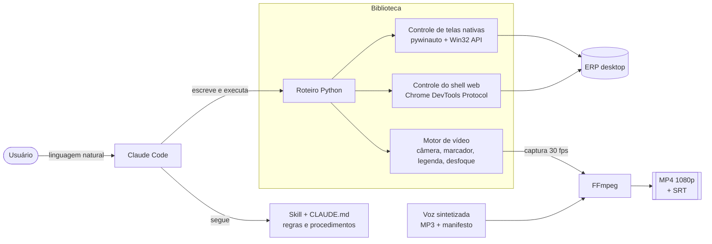
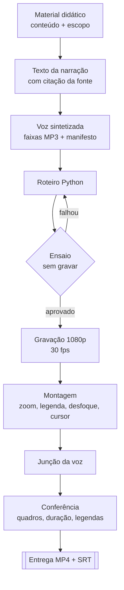

# Automação de testes e vídeos de ERP com IA

> Ferramenta que opera um ERP desktop como uma pessoa faria (abre telas pelo menu, clica, digita, confere) e, a partir disso, **roda testes manuais automatizados** e **grava vídeos narrados de treinamento** prontos para entrega. Orquestrada pelo **Claude Code** por meio de uma skill personalizada.

<!-- Adicione aqui um GIF curto da automação rodando:  -->

**Projeto interno, desenvolvido na WK Sistemas.** O código é da empresa e não está publicado. Este repositório documenta o problema, a arquitetura e as decisões técnicas.

---

## O problema

Os vídeos de treinamento e de demonstração do ERP eram gravados à mão, tela a tela. Cada vídeo exigia percorrer o sistema, gravar, narrar, legendar e editar. Qualquer mudança no sistema ou no texto obrigava a refazer o trabalho.

O mesmo vale para os **testes manuais** de novas funcionalidades: abrir as telas, preencher campos e conferir resultados, repetidas vezes.

## A solução

Uma biblioteca em Python que **controla o ERP de verdade**, com o cursor real e a interface real, em dois modos sobre o mesmo código:

| Modo | Para quê | Saída |
| --- | --- | --- |
| **Regressão** | Executar os cenários de teste de uma funcionalidade quantas vezes for preciso, sem agente | `PASSOU` / `FALHOU` / `BLOQUEADO` por cenário, com JSON e capturas de tela como evidência |
| **Vídeo** | Gravar a demonstração ou a aula de uma tela | MP4 1920x1080 com cursor, marcador de clique, zoom, legenda e narração |

O **Claude Code** opera a ferramenta: lê as regras do projeto (`CLAUDE.md`) e a skill, escreve o roteiro, roda o ensaio, corrige o que falhou, grava e confere a entrega. O usuário conversa em linguagem natural e não precisa digitar comandos.

---

## Arquitetura

### Desafio central: uma interface híbrida

O ERP mistura duas tecnologias, e cada uma pede uma forma de controle diferente:

- **Shell web (Electron).** Menus, barra lateral e busca. Controlado pelo **Chrome DevTools Protocol** via websocket direto. Bibliotecas como o Playwright não conectavam na versão do Chromium embarcada, então a ferramenta fala o protocolo sem intermediários.
- **Telas nativas (MFC, 32 bits).** Formulários, grades, abas e diálogos. Controladas com **pywinauto** e chamadas diretas à **Win32 API**, como `PostMessage`, `AttachThreadInput` e `PrintWindow`. Isso exige **Python de 32 bits**, porque um processo de 64 bits não enxerga todos os controles das telas.

Grande parte das ações funciona **por mensagem do Windows, sem mover o mouse**. Assim, os testes rodam mesmo com a janela coberta. No modo vídeo, as mesmas ações viram cliques reais, com o cursor indo até o alvo para quem assiste.

---

## Pipeline de um vídeo narrado

1. **Narração fiel à fonte.** Cada frase falada sai do material didático, com o trecho de origem anotado. A pergunta "de onde veio isso?" sempre tem resposta.
2. **Ensaio antes de gravar.** O roteiro percorre o sistema inteiro sem gravar. Ele aponta menu errado, campo não encontrado e silêncios longos na trilha de voz, e salva uma prévia de cada enquadramento de câmera.
3. **Gravação.** A ferramenta muda o monitor para 1920x1080, oculta a barra de tarefas e captura a 30 fps. No fim, tudo volta ao estado original, mesmo se o roteiro falhar.
4. **Montagem.** Zoom suave na área de interesse, legenda composta por cima, desfoque de dados sensíveis e cursor visível sobre o desfoque.
5. **Voz.** Cada faixa entra no instante exato em que a legenda correspondente apareceu.

---

## Destaques técnicos

**O ritmo do vídeo segue a voz.** A ação seguinte só começa quando a faixa de narração anterior termina. Isso evita vozes sobrepostas e trechos mudos. Caminhos longos de menu ganham uma fala por nível, sincronizada com o cursor.

**Câmera virtual.** O roteiro só anota quando e onde aproximar. O recorte é feito depois, na montagem, com zoom de 115% a 140% calculado pelo tamanho da área de interesse e transições suaves. Se a nova área já está enquadrada, a câmera fica parada, para não agitar a imagem.

**Marcador de clique.** Um traço desenha a "unidade de sentido" do alvo (campo e rótulo, checkbox e texto, botão, aba), fecha, some e só então vem o clique. Ele não aparece em deslocamentos curtos, em áreas grandes demais nem no shell.

**Proteção de dados.** Uma thread monitora as janelas durante a gravação, localiza CPFs pelo rótulo e pelo formato, e a montagem aplica um desfoque com bordas em degradê. O cursor continua visível por cima.

**Legendas em três formatos.** Imagem composta no vídeo, ASS e SRT (para acessibilidade e plataformas de ensino). Também há um modo que grava sem legenda e a aplica no fim, para quando outra pessoa adiciona animações por cima.

**Diagnóstico de ambiente.** Um comando `verifica` confere Python, pacotes, ERP, porta de depuração, login, escala de tela e se o FFmpeg tem o filtro de captura correto, antes de qualquer gravação.

---

## Decisões de engenharia

- **Verificar o efeito, não o estado.** "A tela abriu" ou "o campo está preenchido" não provam que o passo funcionou, porque o estado podia já estar lá. Os testes conferem a mudança causada pela ação. Essa regra nasceu de um vídeo defeituoso que tinha passado em todas as verificações.
- **Busca sem resultado é "não encontrado".** Nunca a posição onde a busca parou. Isso evita falsos `PASSOU`.
- **Falha silenciosa vira checagem explícita.** Uma versão antiga do FFmpeg gravava sem nenhum erro, mas a cerca de 16 fps, e o vídeo saía travado. A troca para captura via Desktop Duplication (`ddagrab`) levou a cerca de 30 fps reais, e o `verifica` passou a acusar o problema antes de gravar.
- **Gravar em 1080p nativo.** Torna o resultado igual em qualquer máquina, inclusive por acesso remoto, e foi o que permitiu passar a ferramenta para outra pessoa da equipe.
- **Segurança inegociável.** A ferramenta nunca digita senha, nunca transmite documento fiscal, só trabalha em base de demonstração e não exclui o que não criou.
- **Regras com histórico.** Cada regra estranha do projeto está documentada junto com o episódio que a originou. A skill só muda com aprovação humana.

---

## Resultados

- **Em uso real:** vídeos de treinamento já entregues para o material didático da empresa.
- **Reaproveitável:** a mesma biblioteca atende vídeos de aula, demonstrações de funcionalidades e suítes de regressão.
- **Transferível:** documentação e instaladores permitiram que outra pessoa da equipe usasse a ferramenta.
- **Escala do código:** cerca de 4.700 linhas entre Python e PowerShell.

---

## Stack

| Área | Tecnologias |
| --- | --- |
| Linguagem | Python 3.12 (32 bits), PowerShell, Batch |
| Automação de interface | pywinauto, pywin32, Win32 API (ctypes), Chrome DevTools Protocol (websocket-client) |
| Vídeo e áudio | FFmpeg (ddagrab, filtros de recorte, desfoque e mixagem), Pillow |
| IA | Claude Code com skill personalizada, voz sintetizada (TTS) |
| Integração | API REST do Azure DevOps (leitura de cards e casos de teste) |

---

## Autor

**Guilherme Babel Machado** · [LinkedIn](https://www.linkedin.com/in/guilherme-babel-machado-25a4531ba) · [GitHub](https://github.com/Babelg)
