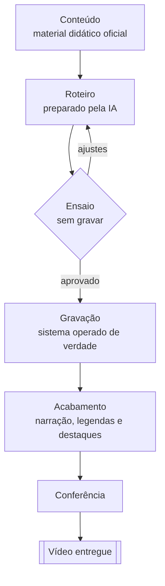

# Automação de testes e vídeos de ERP com IA

> Uma ferramenta que usa um sistema ERP como uma pessoa faria e, a partir disso, **testa funcionalidades** e **produz vídeos narrados de treinamento**, com a IA conduzindo o trabalho do início ao fim.

**Projeto interno, desenvolvido na WK Sistemas.** Este repositório apresenta o conceito e os resultados. A implementação não é pública.

---

## O problema

Produzir vídeos de treinamento de um sistema é um trabalho manual e repetitivo: percorrer as telas, gravar, narrar, legendar e editar. Quando o sistema muda ou o texto precisa de ajuste, boa parte do trabalho recomeça.

Testar novas funcionalidades segue a mesma lógica: abrir telas, preencher campos e conferir resultados, várias vezes.

## A ideia

Em vez de uma pessoa operar o sistema e gravar a tela, a **IA conduz uma ferramenta que opera o sistema de verdade**, com o cursor e as telas reais, e entrega o resultado pronto.

A mesma ferramenta atende duas necessidades:

| Uso | O que entrega |
| --- | --- |
| **Testes** | Executa os cenários de uma funcionalidade e informa, para cada um, se passou ou falhou, com evidências |
| **Vídeos** | Grava a demonstração ou a aula de uma tela, já com narração, legendas e aproximação nos pontos importantes |

A pessoa descreve o que precisa em linguagem natural, e a IA cuida do restante.

---

## Como um vídeo é produzido

1. **Conteúdo.** O texto narrado sai do material didático oficial. Nada é inventado.
2. **Roteiro.** A IA transforma o conteúdo em um passo a passo no sistema.
3. **Ensaio.** O roteiro é executado sem gravar, para encontrar problemas antes da gravação.
4. **Gravação.** O sistema é operado de verdade enquanto a tela é gravada.
5. **Acabamento.** Narração, legendas, destaque dos cliques, aproximação nas áreas importantes e proteção de dados pessoais.
6. **Conferência e entrega.** O vídeo é verificado antes de chegar ao cliente.

---

## Princípios do projeto

- **Ensaiar antes de gravar.** Erros aparecem no ensaio, não no vídeo pronto.
- **Conferir o resultado da ação, não só a aparência da tela.** Um teste só passa quando o efeito esperado realmente aconteceu.
- **Fidelidade ao conteúdo.** Tudo o que a narração diz tem origem no material oficial.
- **Segurança.** Uso apenas em ambiente de demonstração, sem dados reais expostos e com proteção automática de informações pessoais.
- **Vídeo pensado para quem aprende.** Linguagem de cliente, cursor sempre no assunto e legendas fiéis ao que é dito.

---

## Resultados

- **Em uso real:** vídeos de treinamento já entregues para o material didático da empresa.
- **Uma ferramenta, várias demandas:** vídeos de aula, demonstrações de novas funcionalidades e testes.
- **Padronização:** todos os vídeos seguem a mesma qualidade, independentemente da máquina ou de quem opera.
- **Transferível:** a documentação permitiu que outra pessoa da equipe passasse a usar a ferramenta.

---

## Competências aplicadas

Automação de processos · Agentes de IA · Python · Automação de interface · Processamento de vídeo · Garantia de qualidade · Documentação técnica

---

## Autor

**Guilherme Babel Machado** · [LinkedIn](https://www.linkedin.com/in/guilherme-babel-machado-25a4531ba) · [GitHub](https://github.com/Babelg)
